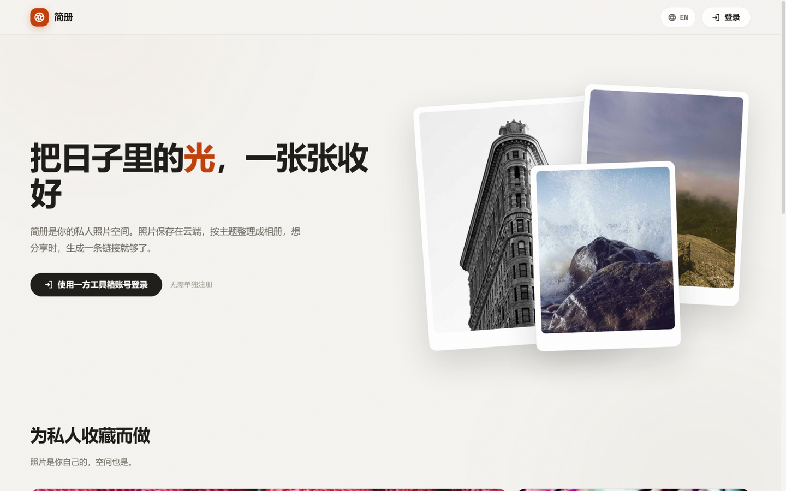
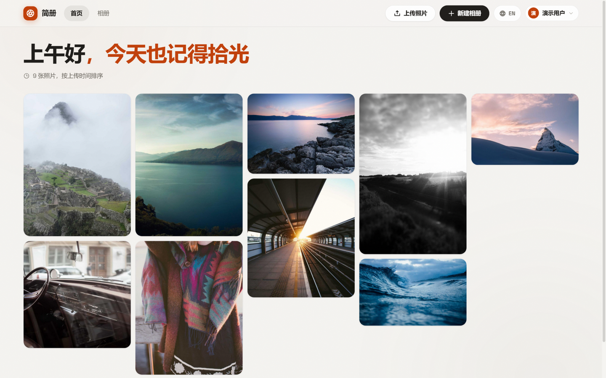
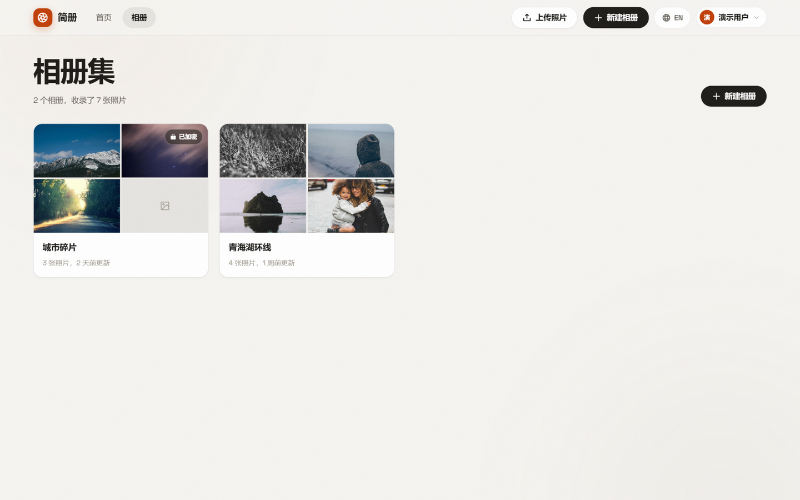
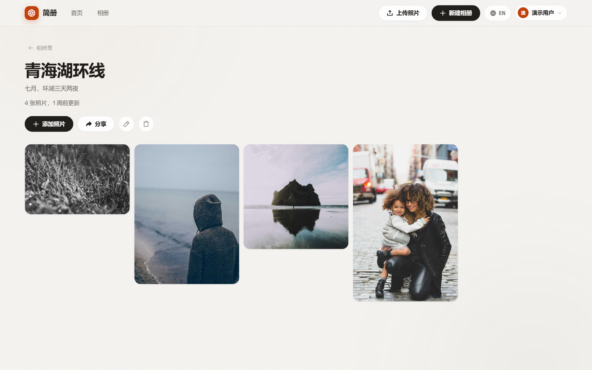
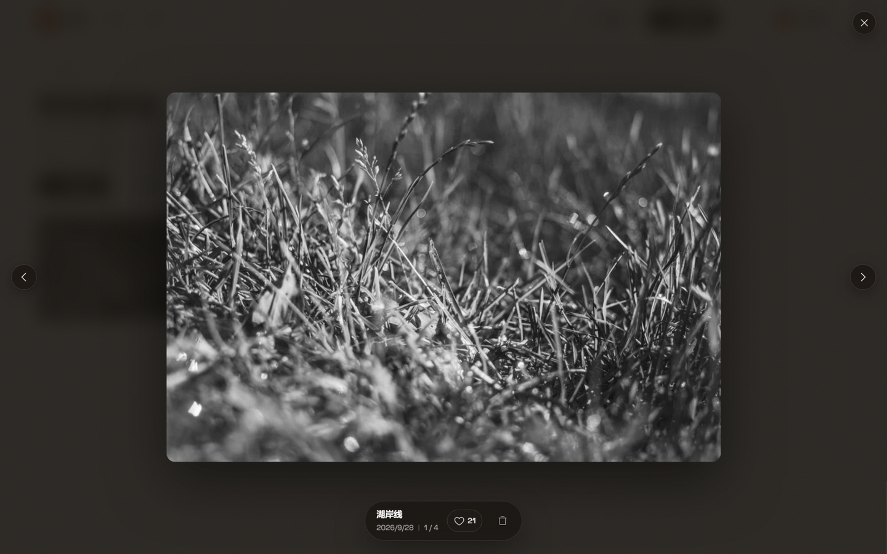
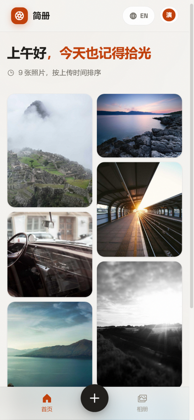

# 简册

部署在 Cloudflare Pages 上的照片相册应用：上传照片进入时间流，整理成相册，一键生成公开分享链接。照片存储在 R2，浏览器直传、字节流不经过 Worker；登录对接工具站 OAuth2 统一认证。

## 截图

| 产品首页（未登录） | 首页时间流 |
| :---: | :---: |
|  |  |

| 相册集 | 相册详情 |
| :---: | :---: |
|  |  |

| 灯箱查看 | 移动端 |
| :---: | :---: |
|  |  |

## 功能

- **照片上传**：单张最大 20MB，支持 jpeg / png / webp / gif / avif / bmp / heic；可选上传前压缩；上传前先校验存储额度
- **时间流 + 相册**：未归档的照片按时间流展示（瀑布流），可随时整理进相册；删除相册时照片自动回到时间流
- **分享链接**：每个相册一个 `/s/:shareId` 只读链接，可附加访问密码；相册密码永不下发到分享页，照片 URL 为随机对象名、不可枚举
- **灯箱**：大图查看、键盘/按钮翻页、点赞、删除
- **统一登录**：OAuth2 授权码 + PKCE 对接工具站（默认 `https://tool.fologde.com`），`client_secret` 只存在服务端；支持令牌自动刷新与撤销
- **跨设备同步**：localStorage 先上屏，登录后拉取 R2 上的画廊清单，按 `updatedAt` 做 last-write-wins 合并后回写
- **中英双语**：按访客 IP 国家自动选择语言（读取 Cloudflare 的 `CF-IPCountry`），可手动切换
- **响应式**：桌面顶栏 + 移动端底部导航

## 技术栈

| 层 | 技术 |
| --- | --- |
| 前端 | React 19 · TypeScript · Vite 7 · Zustand · motion · React Router 7 · Phosphor Icons |
| 后端 | Cloudflare Pages Functions |
| 存储 | Cloudflare R2（bucket：`jiance-photos`） |
| 认证 | 工具站 OAuth2（授权码 + PKCE，scope：`profile storage`） |

## 架构

```text
浏览器 ──OAuth2(PKCE)──> 工具站授权服务器
   │  /api/oauth/*（token / userinfo / revoke，服务端代理注入 client_secret）
   │
   ├── /api/upload-ticket ──> 签发 S3 预签名 PUT（10 分钟有效）──> 浏览器直传 R2
   │        │                  └─ 签发前向工具站 storage-reserve 预扣额度
   │        └─ 失败直接报错，无代理上传降级路径
   │
   ├── /api/gallery GET/PUT ──> 画廊清单（相册 + 照片元数据，按账号私有）
   ├── /api/share/:shareId ──> 公开只读分享数据（无需登录，可选密码门）
   ├── /api/storage/quota   ──> 工具站存储额度查询（上传前校验）
   ├── /api/storage/release ──> 放弃上传时释放预留
   └── /f/:key ──> R2 照片公开读取
```

存储额度记账：`used_bytes` 是工具站 D1 账本（`user_storage_quota`），不是扫 R2
统计的。本站上传走工具站统一上传凭证（`storage-upload-credential`，签发即原子
预扣），上传后的用量结算由工具站队列事件按 `upload_id` 幂等实扣；删除照片走
「HEAD 量大小 → 删对象 → 仅统一通道对象 refund 退还」。本站不持有任何 R2 密钥，
只透传 Bearer 令牌。

R2 对象布局：

```text
subsite/{uid}/{upload_id}/{uuid}.{ext}            # 照片本体（统一凭证通道，计入主站额度）
{prefix}/{uid}/{YYYY-MM-DD}/{32位随机串}.{ext}    # 旧直传通道照片（只读兼容，未计额）
_manifests/{prefix}/{uid}.json                    # 画廊清单（应用内部记账）
_shares/{prefix}/{shareId}                        # 分享索引：shareId → 属主 uid
```

## 本地开发

```bash
npm install

# 前端配置：复制并填写工具站应用的 client_id
cp .env.example .env.local

npm run dev        # 仅前端（Vite，端口 5175）
npm run dev:all    # 先构建，再 wrangler pages dev（带 Functions 与 R2 本地模拟）
```

- `.env.local`：`VITE_OAUTH_CLIENT_ID`（必填）、`VITE_OAUTH_SERVER`（默认 `https://tool.fologde.com`）
- `.dev.vars`：本地 Pages Functions 密钥，放 `OAUTH_CLIENT_SECRET` 即可（上传凭证由工具站签发，本站不再需要 R2 API Token）
- 工具站管理后台的回调地址白名单需加入 `http://localhost:5175/auth/callback`，并在「OAuth 应用 → 编辑」为应用登记 R2 桶名（`jiance-photos`），否则上传返回 `403 upload_not_enabled`

## 部署

```bash
# 1. 创建 R2 bucket（若尚未创建）
npx wrangler r2 bucket create jiance-photos

# 2. 配置生产密钥
npx wrangler pages secret put OAUTH_CLIENT_SECRET --project-name jiance
# 历史遗留的 R2_ACCESS_KEY_ID / R2_SECRET_ACCESS_KEY 可从 Pages 密钥中删除（已不再使用）

# 3. 发布
npm run deploy
```

发布后：

- 在工具站后台把 `https://<你的域名>/auth/callback` 加入回调白名单
- 给 bucket 配置 CORS 允许浏览器直传 PUT（参考 [`r2-cors.json`](r2-cors.json)，用 R2 S3 API 的 `PutBucketCors` 写入）
- 存储额度由工具站统一计费，应用内只读校验；充值入口在登录菜单的「额度管理」

## 目录结构

```text
├─ functions/            # Cloudflare Pages Functions
│  ├─ api/
│  │  ├─ oauth/          # token / userinfo / revoke 服务端代理
│  │  ├─ upload-ticket   # R2 直传预签名
│  │  ├─ upload          # 代理上传（直传不可用时的降级路径）
│  │  ├─ gallery         # 画廊清单读写
│  │  ├─ share/          # 公开分享接口
│  │  ├─ storage/        # 存储额度查询
│  │  └─ country         # 访客国家码（语言自动判断）
│  └─ f/                 # R2 照片公开读取
├─ src/
│  ├─ components/        # UI 组件（灯箱、上传弹窗、相册表单、分享弹窗等）
│  ├─ lib/               # OAuth、画廊同步、上传、i18n、状态存储
│  └─ pages/             # 路由页面（首页 / 相册 / 相册详情 / 分享页 / 回调）
├─ wrangler.toml         # Pages 绑定与 R2 配置
└─ r2-cors.json          # R2 bucket 的 CORS 规则（浏览器直传用）
```

## License

[Apache-2.0](LICENSE)
